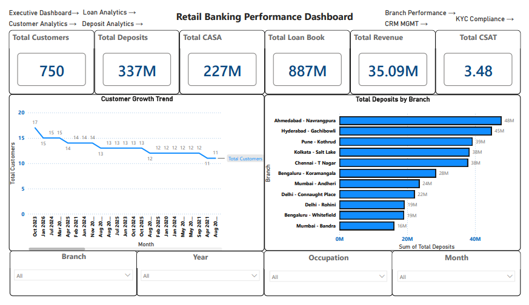
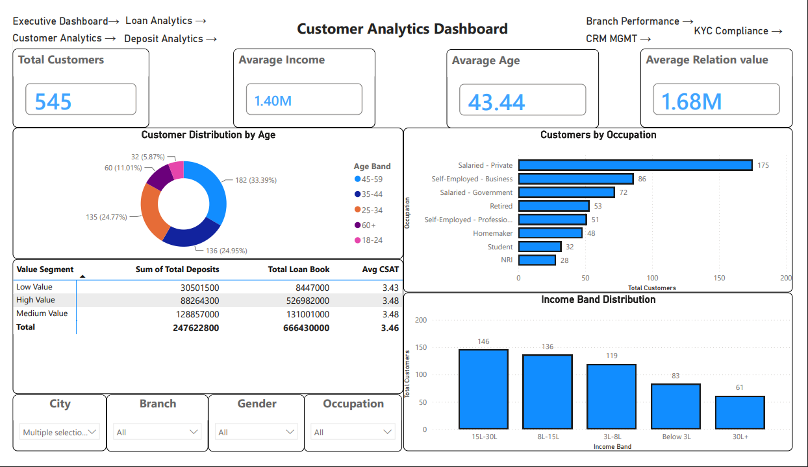
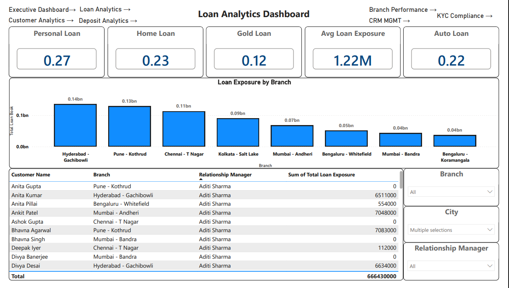
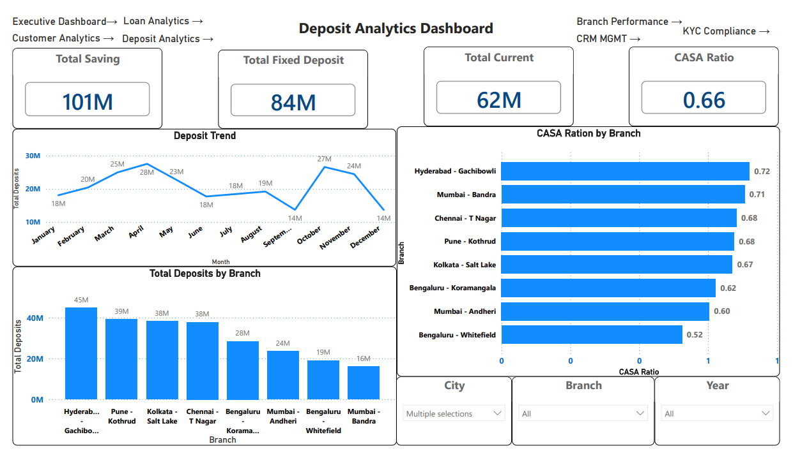
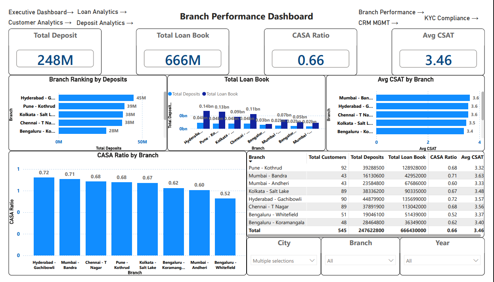
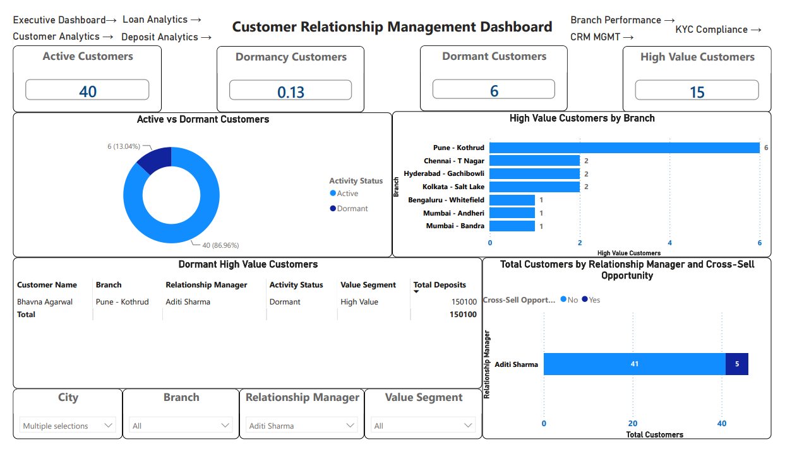
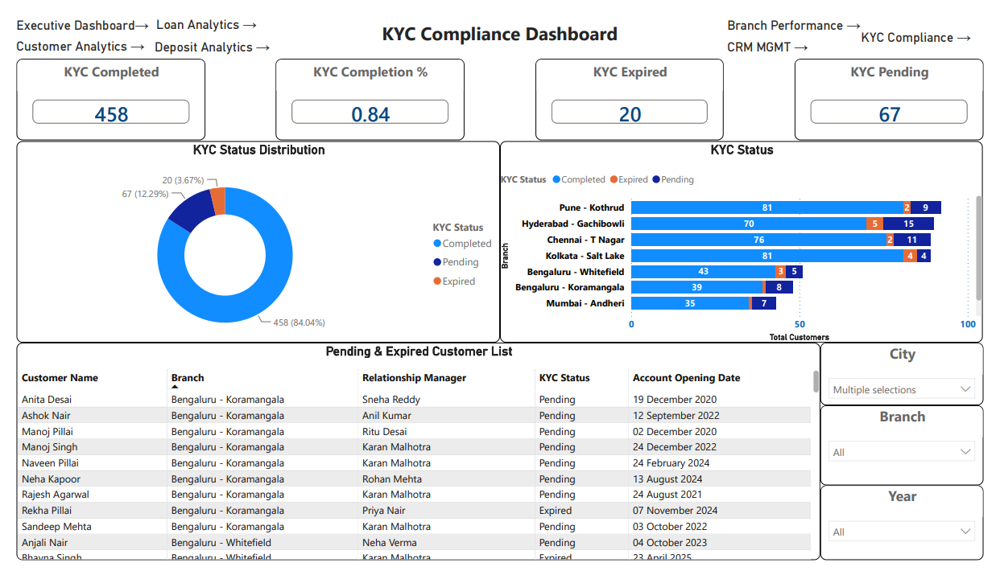

# Retail Banking Performance & CRM Dashboard

A **7-page interactive Power BI dashboard** with a parallel **Microsoft Excel** implementation using **SUMIFS, COUNTIFS, and AVERAGEIFS**. This project analyzes a **synthetic retail banking dataset** of **750 customers** across **11 branches** and **8 cities**, demonstrating how customer-level data is transformed into the key performance indicators (KPIs) monitored by retail banking teams, including **CASA, deposits, loans, cross-selling, CRM segmentation, and KYC compliance**.

> **Data Note:** All customer, account, and branch data used in this project is **synthetically generated** for educational and portfolio purposes. No real customer or bank data has been used.



---

# Key KPIs (Executive Dashboard)

| KPI | Value |
|------|-------|
| Total Customers | **750** |
| Total Deposits | **₹33.68 Cr** |
| CASA Ratio | **67.4%** |
| Total Loan Portfolio | **₹88.71 Cr** |
| Estimated Annual Revenue | **₹3.51 Cr** |
| Average Customer Satisfaction | **3.48 / 5** |
| Cross-Sell Rate (≥3 Products) | **80.1%** |
| Average Products per Customer | **3.62** |

> **Estimated Annual Revenue Assumption:**  
> Calculated using an assumed **3.5% Net Interest Margin (NIM)** on the loan portfolio and a **1.2% average yield/fee income** on the deposit portfolio. These assumptions can be replaced with actual banking data if available.

---

# Dashboard Pages

| Page | Highlights |
|------|------------|
| **1. Executive Dashboard** | KPI Cards (Customers, Deposits, CASA Ratio, Revenue, Loan Portfolio, Customer Satisfaction), Deposits by Branch, Customer Growth Trend |
| **2. Customer Analytics** | Average Income, Average Age, Relationship Value, Age Distribution, Income Bands, Occupation Analysis, Customer Details |
| **3. Loan Analytics** | Loan Portfolio by Product (Personal, Home, Gold, Auto), Average Loan Exposure, Branch-wise Loan Analysis |
| **4. Deposit Analytics** | Savings, Current & Fixed Deposit Analysis, CASA Ratio, Deposit Trend, Branch-wise CASA Ratio |
| **5. Branch Performance** | Branch Ranking by Deposits, Loan Portfolio by Branch, Branch Performance Matrix |
| **6. CRM Management** | Active vs Dormant Customers, High-Value Customer Analysis, Dormant High-Value Customer Reactivation List |
| **7. KYC Compliance** | Completed, Pending & Expired KYC KPIs, Compliance Status Distribution, Customer Compliance List |

All pages support **interactive filtering** using **Branch** and **City** slicers, along with page-specific filters such as **Year**, **Occupation**, and **Relationship Manager (RM)**. A consistent navigation bar enables seamless movement across all report pages.

<details>
<summary><strong>📸 View All 7 Dashboard Pages</strong></summary>

<br>

### Customer Analytics



### Loan Analytics



### Deposit Analytics



### Branch Performance



### CRM Management



### KYC Compliance



</details>

---

# Data Model

### Power BI Dataset

**Customer_Data**

- **750 customer records**
- **24 raw attributes** including customer demographics, account balances, loan details, KYC status, and transaction information
- **13 calculated columns**, including:
  - CASA Ratio
  - Relationship Value
  - Value Segment
  - Customer Tenure
  - Activity Status
  - Cross-Sell Opportunity
  - Product Count
  - Customer Segment
  - Other business metrics

- Currency: **Indian Rupees (INR)**
- Reporting Date (As-of Date): **03-Aug-2026**
- Customer tenure and Active/Dormant status are calculated dynamically based on the reporting date.

### Excel Model

The file **Retail_Banking_Dashboard_Data.xlsx** reproduces the same KPIs using native Excel functions, including:

- SUMIFS
- COUNTIFS
- AVERAGEIFS
- PivotTables

The workbook contains **8 analysis sheets**, with a dedicated **ReadMe** worksheet explaining the calculations and workbook structure.

---

# Tools Used

- **Power BI**
  - Data Modeling
  - DAX
  - Interactive Dashboards
  - Data Visualization

- **Microsoft Excel**
  - SUMIFS
  - COUNTIFS
  - AVERAGEIFS
  - PivotTables
  - Dashboard Reporting

---

# Repository Structure

```text
retail-banking-performance-dashboard/
├── README.md
├── LICENSE
├── .gitignore
├── Retail_Banking_Analysis.pbix
├── Retail_Banking_Dashboard_Data.xlsx
└── screenshots/
    ├── 01-executive-dashboard.png
    ├── 02-customer-analytics.png
    ├── 03-loan-analytics.png
    ├── 04-deposit-analytics.png
    ├── 05-branch-performance.png
    ├── 06-crm-management.png
    └── 07-kyc-compliance.png
```

---

# How to Use

### Power BI

Open **Retail_Banking_Analysis.pbix** in **Power BI Desktop** to explore:

- Interactive dashboards
- Cross-filtering
- Drill-down analysis
- Dynamic slicers
- Page navigation

### Excel

Open **Retail_Banking_Dashboard_Data.xlsx** to explore the same business metrics using Excel formulas and PivotTables.

Start with the **ReadMe** worksheet for an overview of the workbook structure.

---

# Author

**Author:** Saranga Abhishek  
🔗 [GitHub](https://github.com/abhishek209-hoop)
